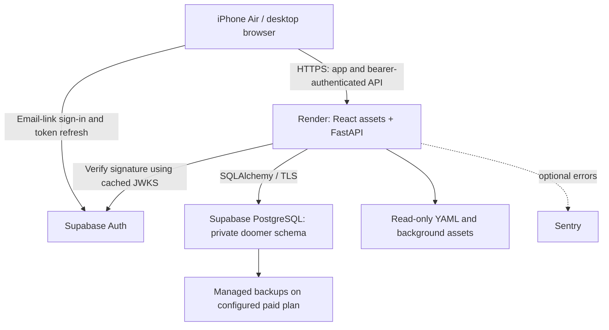

# Architecture

## Decisions

| Concern | Choice | Reason |
| --- | --- | --- |
| UI | React, TypeScript, Vite, plain CSS, Lucide icons, locally hosted fonts | Mobile feed with native scrolling, small component surface and no UI framework lock-in |
| API | FastAPI with SQLAlchemy | User-requested Python backend; explicit, testable persistence |
| Production database | Managed Supabase PostgreSQL | Durable state shared across devices; managed backup option |
| Identity | Supabase passwordless email link | One private owner, no password management in this app |
| Hosting | One Docker-based Render web service | Serves the built frontend and API from one HTTPS origin |
| Local mode | FastAPI plus a separate SQLite file | Immediate preview without cloud credentials; never a production fallback |
| Content | Original YAML collections in `dooms/` | Existing reel-it format remains the single source of truth |
| Observability | JSON request logs, liveness/readiness endpoints, optional Sentry | Enough to identify failures with modest operational overhead |

This application uses a Python process and a regular PostgreSQL connection. The Sites plugin's Worker runtime is not used for this deployment, because it would change the selected FastAPI architecture.

## Storage and ownership

`doomer.topic_state` has a composite key `(user_id, topic_id)`, the current doom ID, an integer version, an optional `finished_at` and a timestamp. A finished topic remains a durable exclusion. It is not deleted when its content disappears temporarily.

`doomer.reaction` has a composite key `(user_id, doom_id)`, a single `like`/`dislike` value and a timestamp. Removing a reaction deletes that row. No social counts or public activity feed are introduced.

The browser never connects directly to either application table. The backend derives user identity from a verified Supabase JWT, verifies the configured owner's email and scopes every state query to that user ID. An arbitrary user ID supplied by a browser is not accepted. The private `doomer` schema should remain outside the Supabase Data API's exposed schemas.

Use an asymmetric signing key (ES256 or RS256) in Supabase. The backend verifies signature, issuer, audience, expiry and authenticated role using the project's JWKS endpoint. An HS256 shared signing secret is intentionally not distributed to the browser or supported by this app. [Supabase JWT verification](https://supabase.com/docs/guides/auth/jwts).

## Navigation and consistency

The library endpoint returns unfinished topic summaries. The client picks uniformly from eligible topics. Topic switching excludes the current topic; if none remain, it retains the current card. Opening a selected topic fetches the latest saved position and reactions.

Native CSS scroll snapping advances vertically. A directional threshold recognizes a right swipe while preserving vertical gestures. The layout uses a dynamic viewport, safe-area padding and a bottom action area. The primary target is iPhone Air's 420 x 912 logical layout. [Apple layout reference](https://developer.apple.com/design/human-interface-guidelines/layout).

Progress writes carry an expected version. The backend atomically updates only a matching unfinished record and increments its version. A stale write returns 409. The retry action restores the latest position from the server after a conflict. Finish is idempotent and no progress request can clear its completion flag. Reactions use a single-row upsert; the last committed reaction wins.

The UI confirms successful writes and exposes save failures. It does not promise offline operation or queue offline Finish/reaction actions. Active content stays readable while present in the page, but pending progress must succeed before changing topics. Returning to the app refreshes the current topic from the server, including reactions and exclusions made on another device. Cross-device persistence becomes active after production services are configured; local mode has separate state.

## Content lifecycle

At startup the catalog loads every root-level YAML reel inside each collection. It validates the shared JSON Schema, ordering, source metadata and local asset paths, and refuses malformed content. Backgrounds are served through authenticated API routes; original PDFs and YAML files are not exposed as static web directories. Text is rendered as text, never as HTML.

Collection slugs and doom IDs are persistent identity. Keep them stable to preserve saved positions, reactions and finished exclusions. An intentionally new revision slug is a separate topic; do not publish a revision as a new slug if the desired behavior is to keep the existing topic's completion state. Content additions enter the running catalog on restart/redeploy. Original documents are preserved.

## Scaling boundary

One service is adequate for this private application. PostgreSQL is external to ephemeral application containers. There is no Redis, job queue, Kubernetes cluster or self-managed metrics stack. Add components only when actual traffic or features need them.
