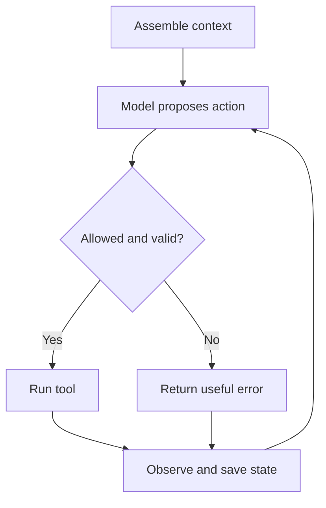

**Illustrative example**

A support agent wants to look up an order. The harness checks that the order belongs to the user, runs the lookup and returns its result.

The model then decides whether it has enough information to answer. A failed lookup returns an error it can handle, rather than silently turning into an invented delivery date.

*Added explanatory diagram.* [Editable diagram](diagrams/example-64.mmd) · [Portable image](images/example-64.svg)
