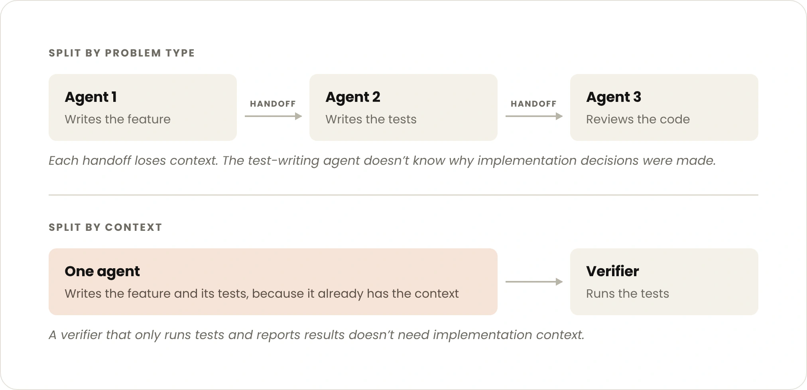

The article recommends a small central team owning the system prompt and end-to-end quality, with new tools and evaluations vetted before release. Domain teams can still contribute specialized knowledge.

Where multiple agents remain, choose simple boundaries with little shared context and compact outputs, such as independent research or black-box **verification**. Splitting tightly related work by problem label can create a repeated telephone game of degraded detail.

*Source: Anthropic’s article. Tap to enlarge; the complete figure is preserved.*
