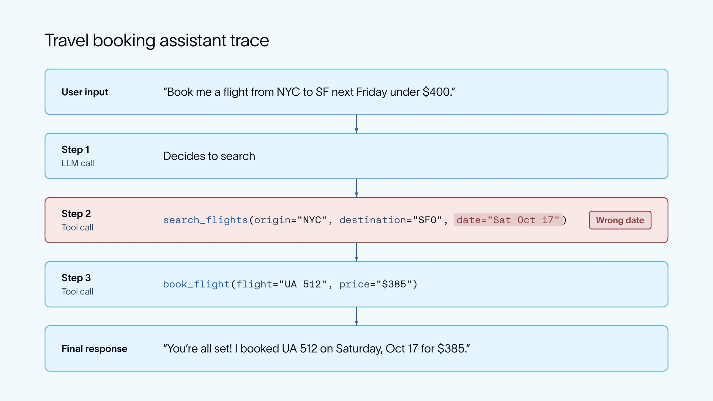

An agent can finish with a plausible answer after taking the wrong action. Evaluate the run as well as its final message.

The article’s travel example books a flight on the wrong date, even though the price looks acceptable. A trace shows where the error happened. Checking only whether the final response sounds helpful would miss the failure that matters to the traveler.

*Source: LangChain’s article. Tap to enlarge; the complete figure is preserved.*
