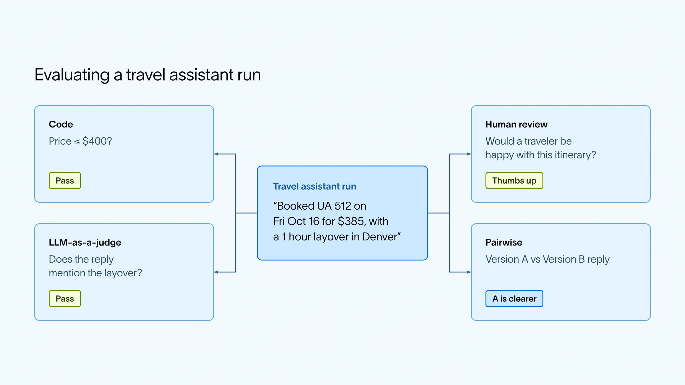

Choose a check that matches the question:

- **Code:** exact rules, such as whether a price fits the budget.
- **An LLM judge:** meaning, such as whether the reply mentions a layover.
- **A person:** judgments that need human context.
- **A pairwise comparison:** which of two responses works better.

These checks answer different questions. One overall score can hide an important failure.

*Source: LangChain’s article. Tap to enlarge; the complete figure is preserved.*
