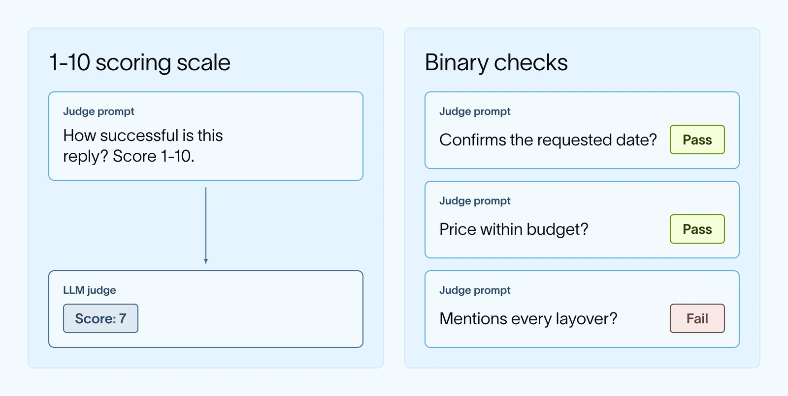

A model judge can assess whether an answer is supported by retrieved evidence, but its decisions may drift from the team’s judgment. Have people score sample runs, inspect disagreements, and refine the rubric or examples.

Ask narrow questions and use descriptive categories or pass/fail. A vague one-to-ten quality score makes distinctions such as six versus seven difficult to reproduce consistently.

*Source: LangChain’s article. Tap to enlarge; the complete figure is preserved.*
