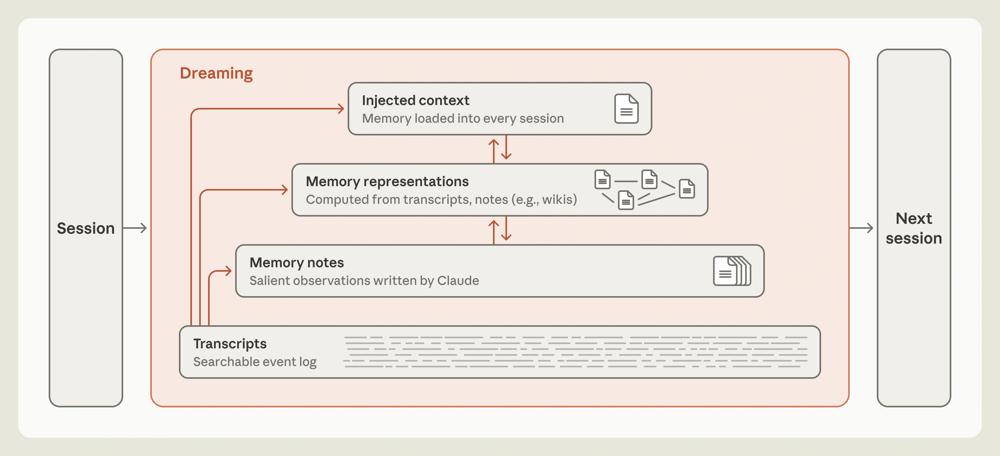

Each layer answers a different question.

- **Transcripts** record what happened and can be searched later.
- **Notes** save observations that seem useful.
- **Linked pages** organize knowledge around topics.
- **Injected context** loads a small set of information at the start of every session.

The lower layers can hold more detail. The top layer takes up space in every new session.

*Figure 1 from Anthropic. Illustration by Monika Tuchowska.*
