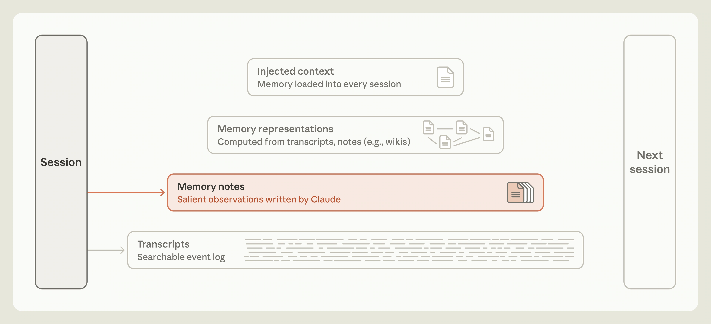

An agent can flag an important event in the transcript or write a note while it still understands why the event matters. The note is ready for the next turn or session.

The hard part is deciding what deserves that treatment. At the time of writing, the agent can only guess which observations a future task will need.

*Figure 2 from Anthropic. Illustration by Monika Tuchowska.*
