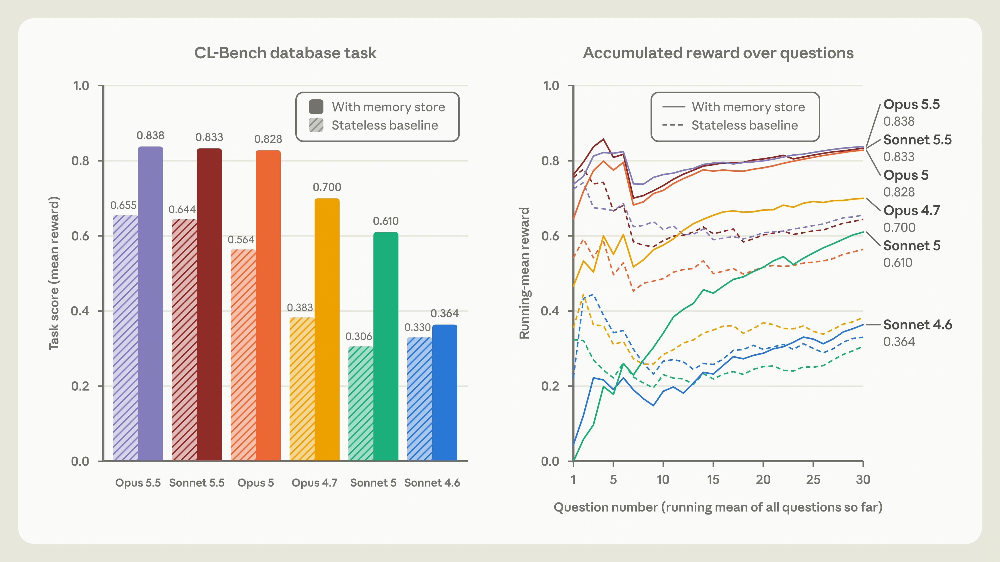

On Anthropic’s CL-Bench database task, Opus 5 went from **0.564 to 0.828** mean reward with memory. Sonnet 4.6 went from **0.330 to 0.364**. Opus 5.5 and Sonnet 5.5 started higher and finished close to Opus 5 with memory.

These scores describe this task. The comparison shows why giving a model a folder and checking how it uses the folder are separate steps.

*Figure 3 from Anthropic. Illustration by Monika Tuchowska.*
