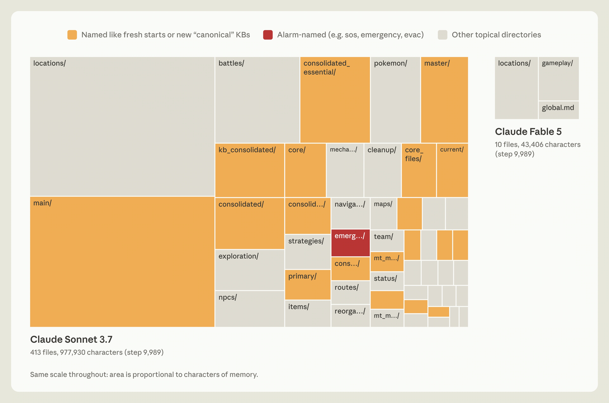

Anthropic compared one Pokémon Red run per model at about 10,000 steps. Sonnet 3.7 saved **413 files** and earned **one badge**. Fable 5 kept **10 files** and earned **four badges**.

Sonnet recorded individual battles, encounters, and items. Much of that detail went stale as the game changed. The comparison illustrates two memory habits in these runs, with the models differing as well as the size of their notes.

*Figure 4 from Anthropic. Illustration by Monika Tuchowska.*
