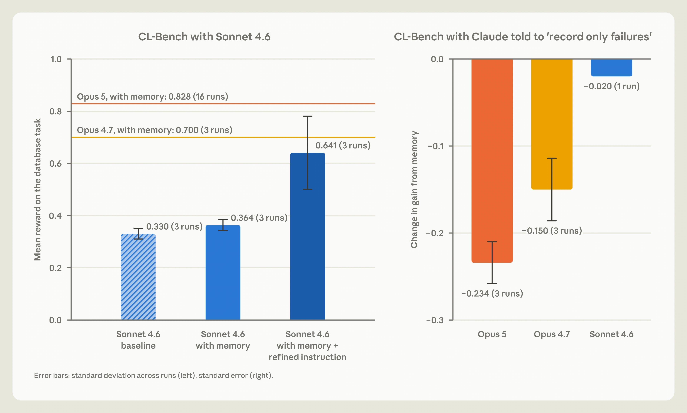

On the database task, telling Opus 5 and Opus 4.7 that a memory folder was available helped them. Telling them to save only failures reduced much of that benefit. Opus 5’s memory gain dropped by **0.234** and Opus 4.7’s by **0.150** mean reward.

Rules about what to keep shape what future sessions can learn. A successful method or a verified fact can deserve a note too.

*Figure 5 from Anthropic. Illustration by Monika Tuchowska.*
