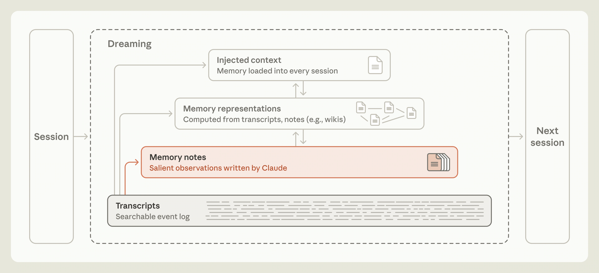

A note can start out wrong or become stale. A future agent may treat it as settled because it arrived from an earlier session.

A background pass can compare the claim with what the transcript actually records. Look for the observations and tool results that support it. When the evidence contradicts the note, revise it so the next session starts from a better account.

*Figure 6 from Anthropic. Illustration by Monika Tuchowska.*
