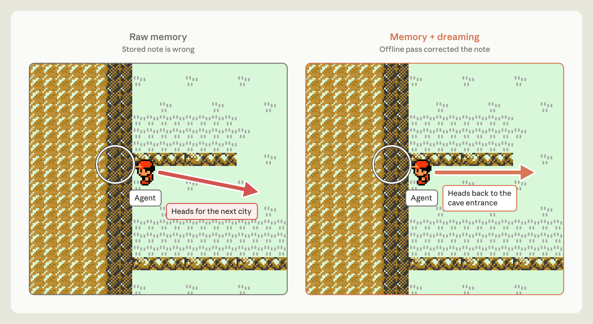

Claude saved the PokéCenter on the east side of Mt. Moon, although it was near the west entrance. When it left the building, it thought it had already crossed the mountain. It walked off a one-way ledge and ended up back on the route it came from. Its navigation tool missed the drop.

Anthropic’s background pass checked the transcript, corrected the landmark, and gave the next run a reason to re-enter the cave.

*Figure 7 from Anthropic. Illustration by Monika Tuchowska.*
