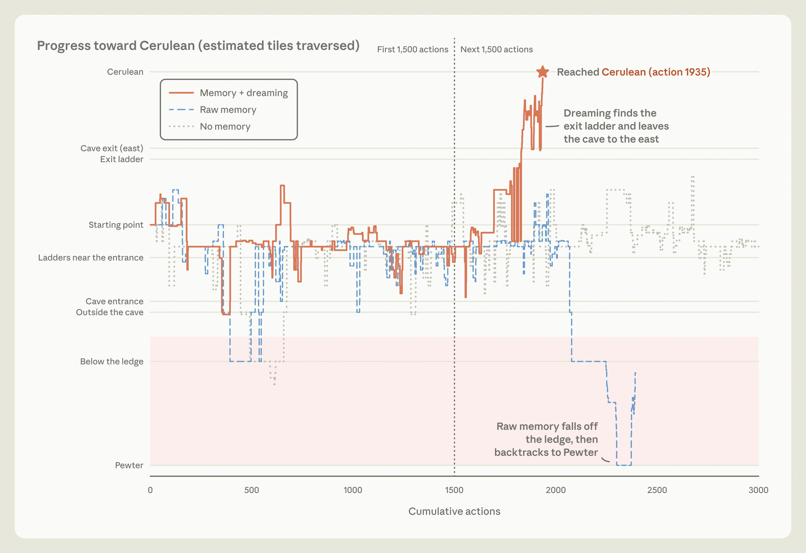

With the corrected note, Claude re-entered Mt. Moon and reached Cerulean City at **action 1,935**. The raw-memory run fell off the ledge three times and eventually returned to Pewter City after the setup told it to keep going. The no-memory run also fell short of Cerulean.

These are the paths Anthropic observed in this comparison. The chart makes the effect of that particular mistaken note easier to trace.

*Figure 8 from Anthropic. Illustration by Monika Tuchowska.*
