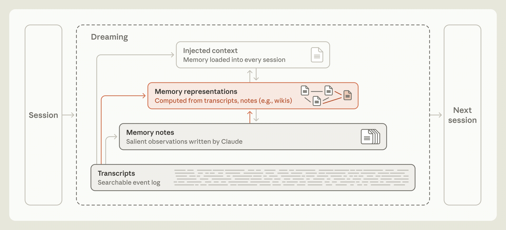

A wiki gathers related details into pages and links those pages to one another. An agent can start from a subject it recognizes and follow the links to adjacent facts, decisions, or evidence.

Anthropic used successive sessions to add pages, merge duplicates, prune old material, and check claims against source files. A shared log let each session pick up where the previous one stopped.

*Figure 9 from Anthropic. Illustration by Monika Tuchowska.*
