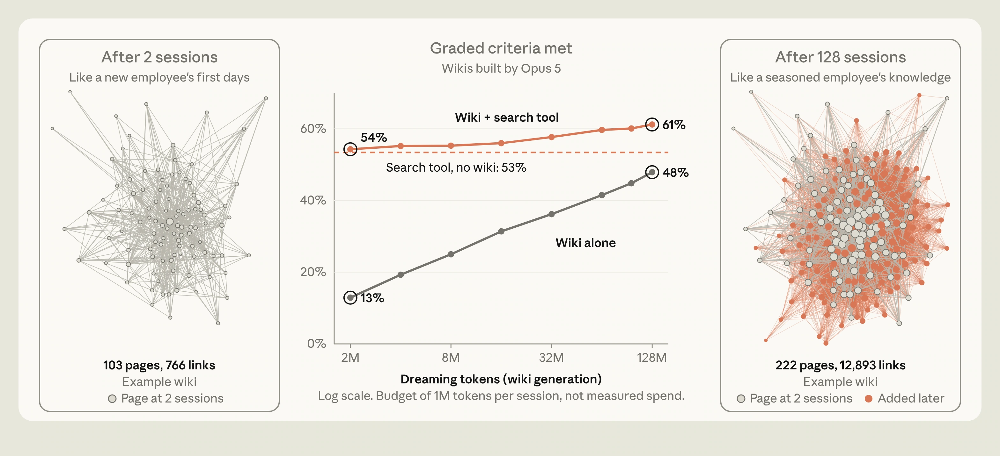

Anthropic gave Opus 5 about **350,000 Stainless files**, roughly **420 million tokens**, and graded answers to 25 questions. The agents built a linked wiki across repeated background sessions.

Using the wiki alone, Claude met **13% of graded criteria after two build sessions** and **48% after 128**. The chart’s horizontal axis uses a budget of one million tokens per session. It shows allocated budget, with actual spending left unmeasured there.

*Figure 10 from Anthropic. Illustration by Monika Tuchowska.*
