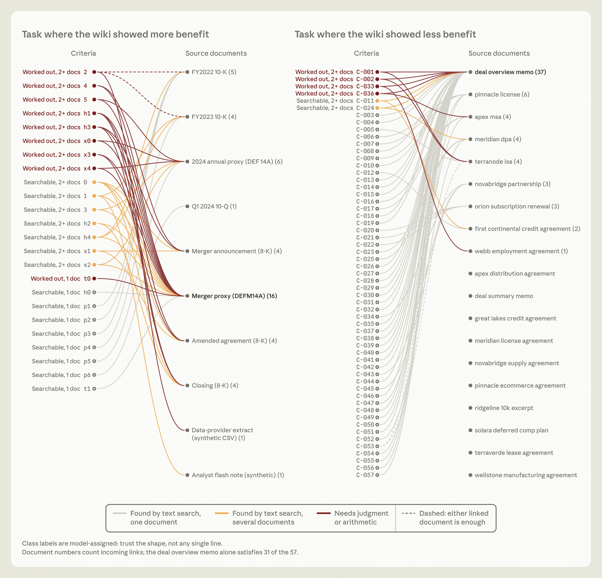

Anthropic asked 24 questions about a merger. Many required joining information across documents, and some needed judgment or arithmetic. On the items highlighted in the article, consulting the wiki scored **87%**, compared with **73%** for search alone.

A Harvey LAB brief showed no clear gain where a direct text search could find most of the evidence in a single document. The shape of the evidence matters when deciding whether to build a wiki.

*Figure 11 from Anthropic. Illustration by Monika Tuchowska.*
