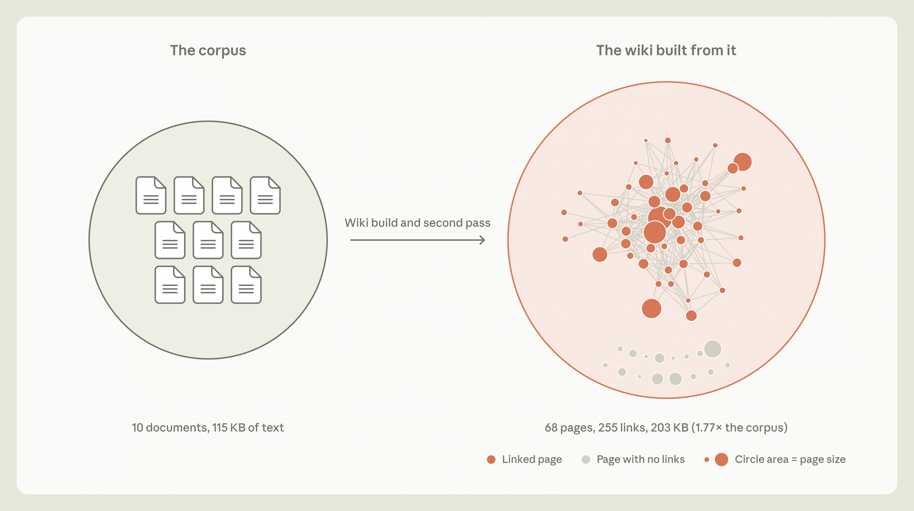

In another legal benchmark task, Claude turned **115 KB** of source documents into a **203 KB** wiki. Some pages had no links. The article compares it with Borges’s fictional map as large as the territory it describes.

When judging a wiki, check how much easier it makes a task. Growth in pages and links can reflect more maintenance work without providing a useful abstraction.

*Figure 12 from Anthropic. Illustration by Monika Tuchowska.*
