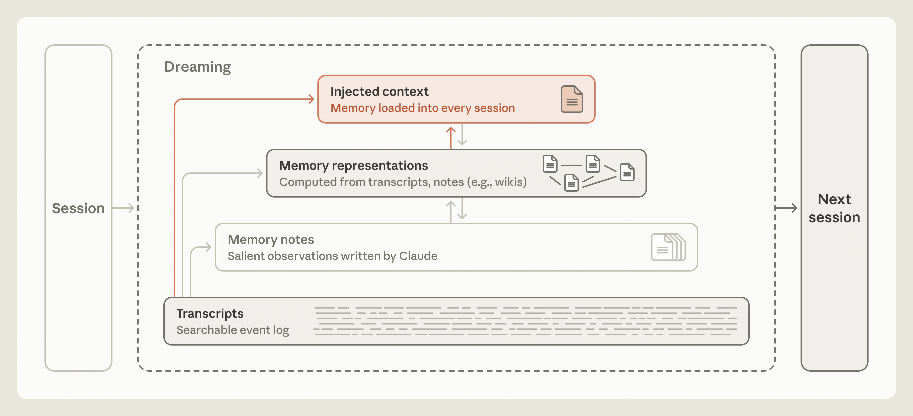

Some information is important before an agent knows to look for it. The harness can load selected notes at the start of every session. This is **context injection**.

Those notes consume tokens every time, and a mistaken entry can steer every new session. Long instructions can also be harder to follow. Keep the startup layer small and move details into files that the agent can open when needed.

*Figure 13 from Anthropic. Illustration by Monika Tuchowska.*
