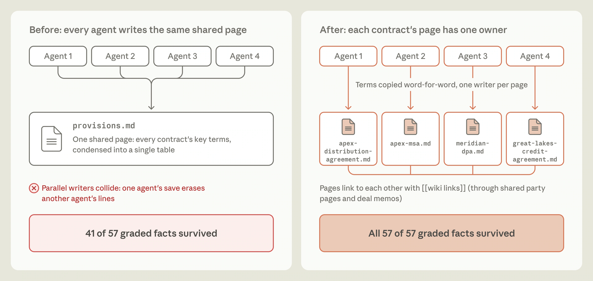

Claude reflected on the failed legal brief, revised the wiki instructions, and rebuilt the wiki. The new instructions assigned **one writer per contract page** and had it copy the relevant terms exactly.

The first brief included **41 of 57** graded facts. The revised wiki let the brief meet **all 57**. Both page ownership and how terms were captured changed, so the comparison measures their combined effect in that task.

*Figure 14 from Anthropic. Illustration by Monika Tuchowska.*
