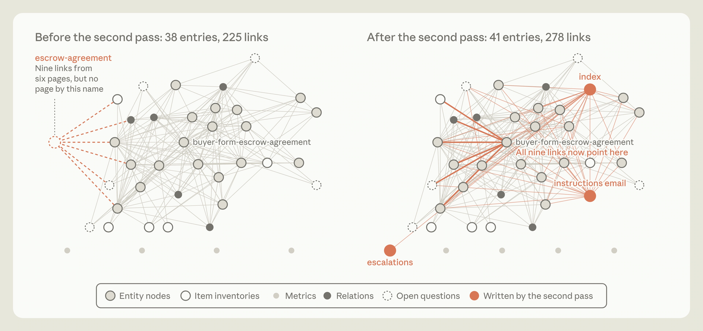

A single writing session can miss connections that become clear when you look across the wiki. In one Harvey LAB task, nine links pointed to an escrow page that had never been created.

A second background pass found the existing page for that document and updated all nine links. It also added three pages, including an index. The repair made earlier work easier to find across sessions.

*Figure 15 from Anthropic. Illustration by Monika Tuchowska.*
