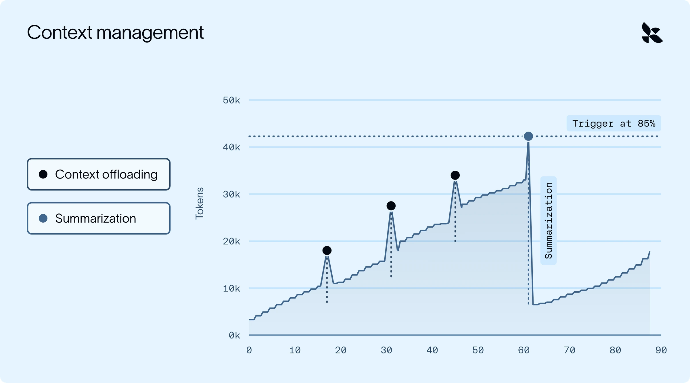

Offloading handles large individual results. Small messages can still accumulate into a long conversation.

The article uses summarization to reduce that gradual growth when context approaches a threshold. Keep the task, decisions and important references in the summary. Saving the earlier conversation makes it possible to recover details that the summary leaves out.

*Source: LangChain’s article. Tap to enlarge; the complete figure is preserved.*
