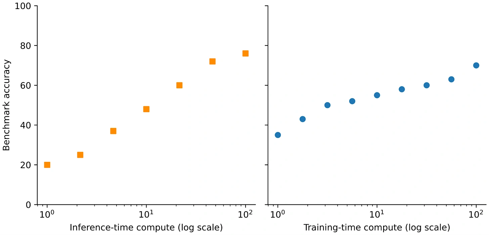

You can spend more compute at two different times:

- **Training:** improve the model before anyone asks a question.
- **Inference:** let it spend more work answering a particular question.

The article compares these ways of improving results. More inference-time work can help some tasks, but its value depends on the model, task and method. It also adds latency and cost.

*Source: Sebastian Raschka’s article; paper credits remain in the original diagram. Tap to enlarge; the complete figure is preserved.*
