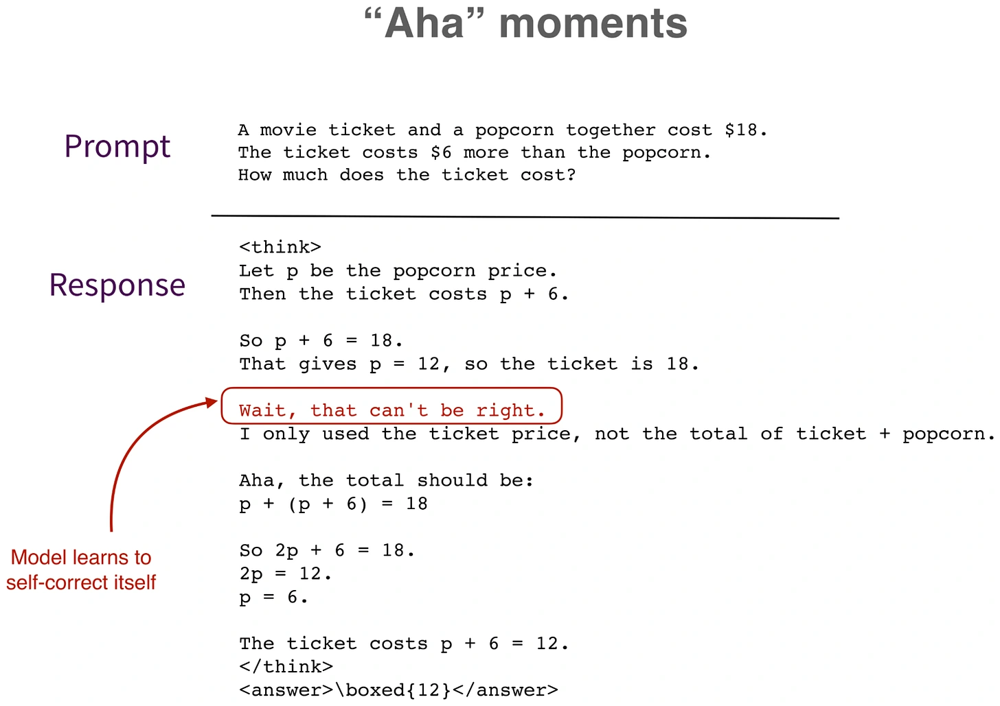

A model trained on final outcomes can learn to generate intermediate explanations, notice mistakes, backtrack, and revise its approach. The article calls these visible self-corrections “aha” moments.

That does not mean a human-like insight has been established. The interesting training result is narrower: the model can acquire useful reasoning-trace behavior without every intermediate step receiving its own explicit correctness reward. Better outcomes can encourage strategies that help produce them.

*Source: Sebastian Raschka’s article; paper credits remain in the original diagram. Tap to enlarge; the complete figure is preserved.*
