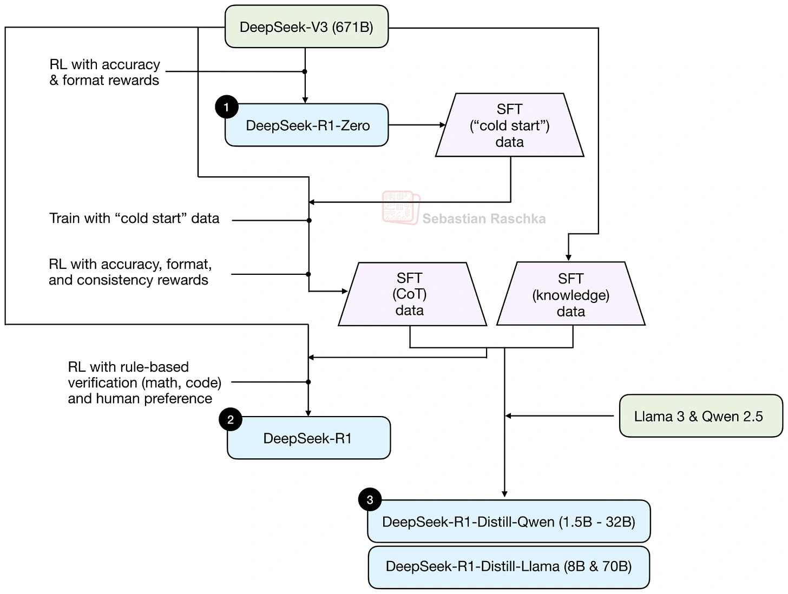

DeepSeek-R1-Zero applied RLVR directly to a pretrained base model, showing that reasoning-trace behavior could emerge without a preceding supervised fine-tuning stage. The full R1 model used a more elaborate pipeline and was stronger.

Raschka also credits Kimi K1.5, published on arXiv the same day as R1, and Tülu 3, which had already used the term RLVR. The popular R1 story sits within a broader research history.

*Source: Sebastian Raschka’s article; paper credits remain in the original diagram. Tap to enlarge; the complete figure is preserved.*
