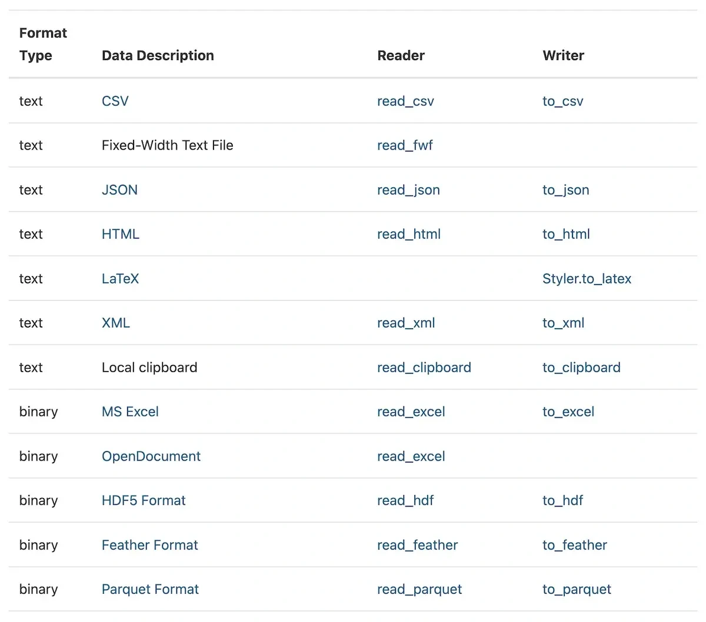

An **adapter** translates one representation into the interface another component expects.

A data pipeline may read CSV, JSON and Parquet, then pass them to the same processing code. Pandas and Spark readers illustrate this idea; Arrow provides a shared columnar representation. Fewer format-specific assumptions need to spread through the rest of the pipeline.

*Source: Eugene Yan’s article; underlying paper credits remain in the figure and linked source. Tap to enlarge; the complete figure is preserved.*
