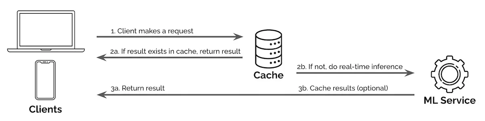

When a small set of search queries accounts for many requests, a service can check cached results before invoking the production inference path. A hit returns immediately; a miss proceeds to computation.

Yan describes this as a proxy acting on behalf of another service. Reusing common query results can reduce real-time compute for suggestions, classification, **retrieval** or ranking.

*Source: Eugene Yan’s article; underlying paper credits remain in the figure and linked source. Tap to enlarge; the complete figure is preserved.*
