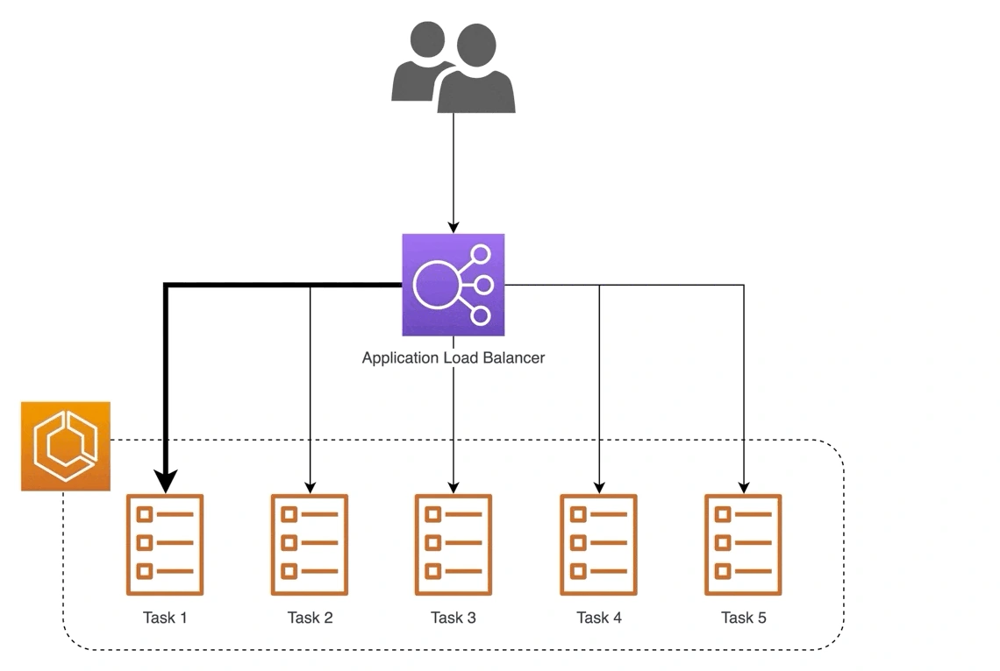

Horizontal scaling creates several model-serving machines, but clients can still use one address. A reverse proxy receives requests and distributes them among the backends.

Yan distinguishes the broader proxy role from load balancing alone. Depending on the setup, the proxy can also cache responses, limit direct backend exposure and terminate encrypted connections, centralizing responsibilities that individual model servers need not each implement.

*Source: Eugene Yan’s article; underlying paper credits remain in the figure and linked source. Tap to enlarge; the complete figure is preserved.*
