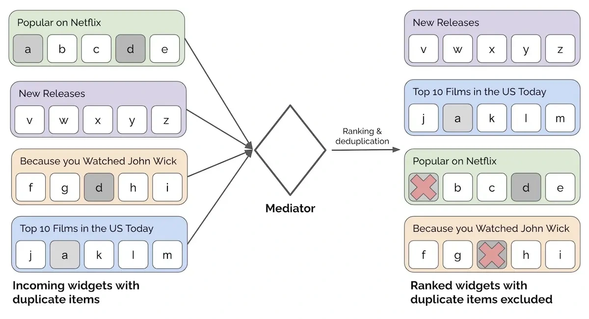

Separate recommendation widgets may each look sensible while producing a poor page together. Yan's mediator example ranks widgets, checks minimum content and removes duplicate items across placements.

The closing point is: naming the pattern helps explain why coordination belongs in that component. Choosing an appropriate pattern communicates intended use as well as organizing the implementation.

*Source: Eugene Yan’s article; underlying paper credits remain in the figure and linked source. Tap to enlarge; the complete figure is preserved.*
