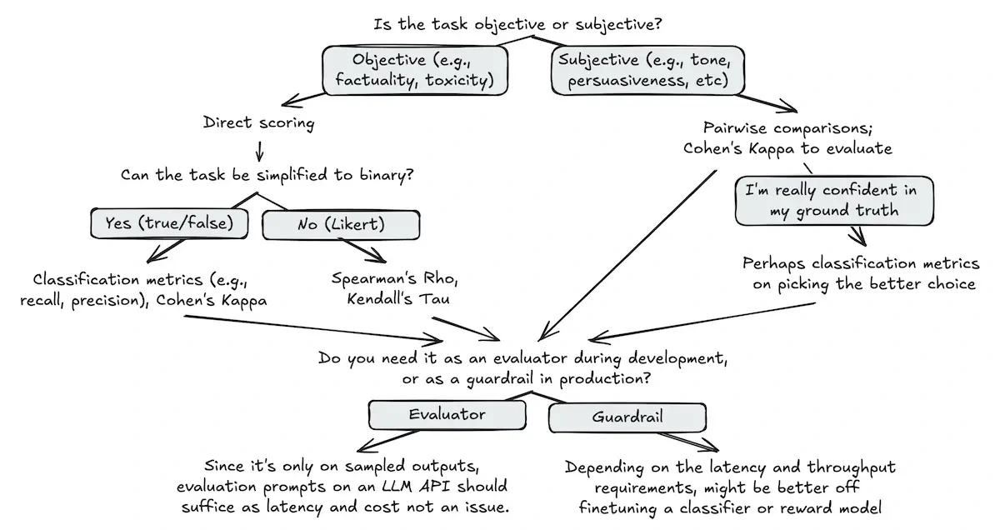

An LLM can judge another model’s output, but that judge can also make mistakes. Evaluate it against judgments that matter for your task.

Eugene Yan reviews approaches for scoring, comparing and critiquing responses. Their strengths vary with the criterion, data and human baseline. Success on one benchmark does not establish that the same judge is reliable for your product.

*Source: Eugene Yan’s article; underlying paper credits remain in the figure and linked source. Tap to enlarge; the complete figure is preserved.*
