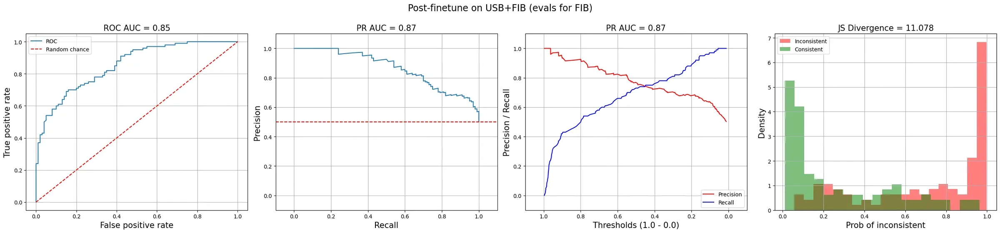

A strong overall correlation can hide failures you care about. Inspect which examples the judge passes and rejects.

A **confusion matrix** separates real failures it catches, failures it misses, acceptable answers it rejects, and acceptable answers it passes. These groups reveal whether a judge is useful for the intended decision. Ranking answers and blocking defects require different evidence.

*Source: Eugene Yan’s article; underlying paper credits remain in the figure and linked source. Tap to enlarge; the complete figure is preserved.*
