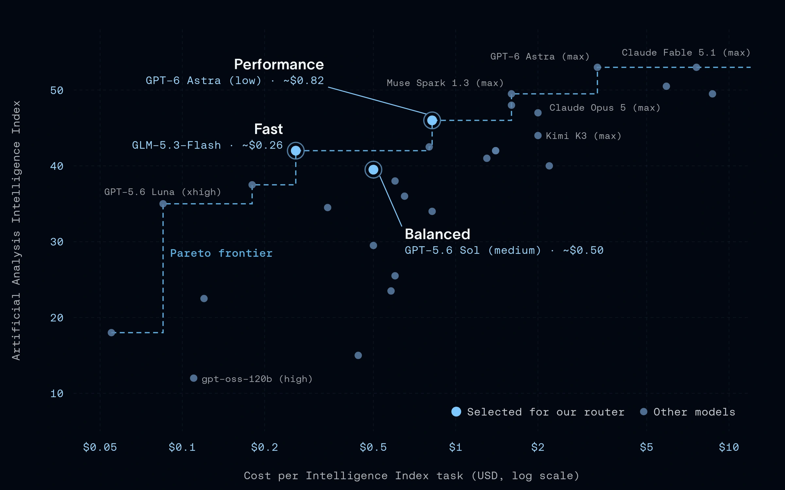

Compare models by task quality and cost. Look for choices where improving quality would require paying more: the **cost-quality frontier**.

The article selects fast, balanced and performance tiers from that comparison. These are roles in the router, rather than a claim that one model is always best. Prices, models and results are snapshots of the reported experiment.

*Source: LangChain’s article. Tap to enlarge; the complete figure is preserved.*
