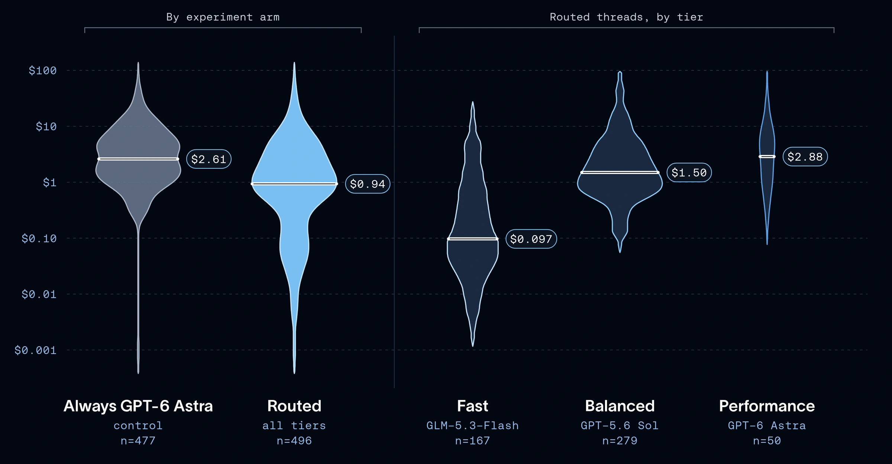

Against always using GPT-6 Astra, the routed median cost was $0.94 versus $2.61. Mean cost fell 42% and the ninetieth percentile fell 37%, suggesting savings beyond a handful of tiny requests.

These are results from Open SWE’s traffic and selected models. They demonstrate the potential of routing in that setting, rather than promising the same percentage for a different agent or pricing schedule.

*Source: LangChain’s article. Tap to enlarge; the complete figure is preserved.*
