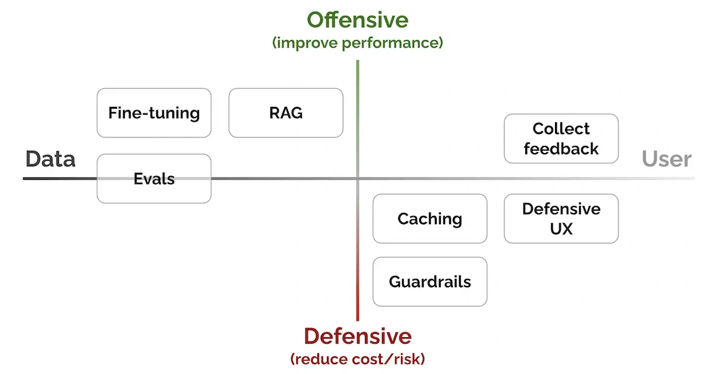

A working demo shows that a language model can do something useful. A dependable product needs more around it.

Eugene Yan organizes that work into seven patterns: evaluation, retrieval, fine-tuning, caching, guardrails, defensive user experience and feedback. Choose them according to the problem you need to solve. Together, they connect model behavior to quality, cost and the user’s experience.

*Source: Eugene Yan’s article; underlying paper credits remain in the figure and linked source. Tap to enlarge; the complete figure is preserved.*
