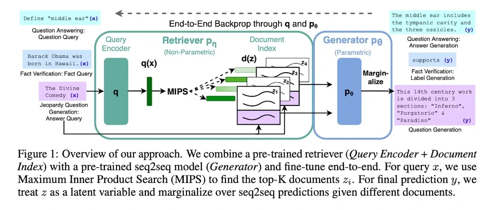

**Retrieval-augmented generation**, or RAG, gives the model relevant material from outside its weights. Search first, then use the retrieved material while generating the answer.

This can supply current or specialized knowledge. The result still depends on finding the right evidence and using it correctly. Evaluate retrieval and the final answer together, rather than assuming that adding a search step guarantees accuracy.

*Source: Eugene Yan’s article; underlying paper credits remain in the figure and linked source. Tap to enlarge; the complete figure is preserved.*
