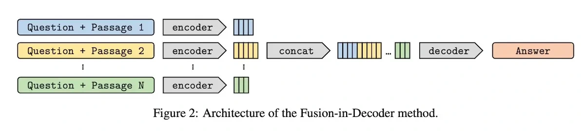

FiD pairs each retrieved passage with the question and encodes those pairs separately. Its decoder then attends across the encoded material to generate an answer.

Yan highlights the scaling benefit of avoiding joint encoder self-attention across every passage at once. Separating encoding from final evidence combination lets the system use many passages while retaining a way to integrate information during decoding.

*Source: Eugene Yan’s article; underlying paper credits remain in the figure and linked source. Tap to enlarge; the complete figure is preserved.*
