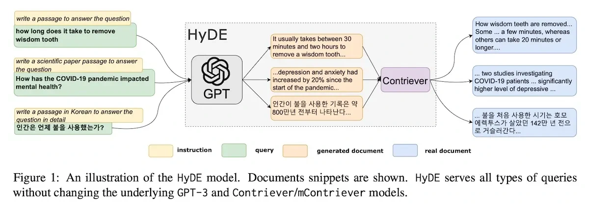

**HyDE** searches using a hypothetical document. The model first drafts what a relevant answer or passage might look like, then embeds that text to retrieve real documents.

The draft is a search aid, not verified evidence. Ground the final answer in the retrieved material. The article presents this as one way to bridge the wording gap between a user’s short question and useful source passages.

*Source: Eugene Yan’s article; underlying paper credits remain in the figure and linked source. Tap to enlarge; the complete figure is preserved.*
