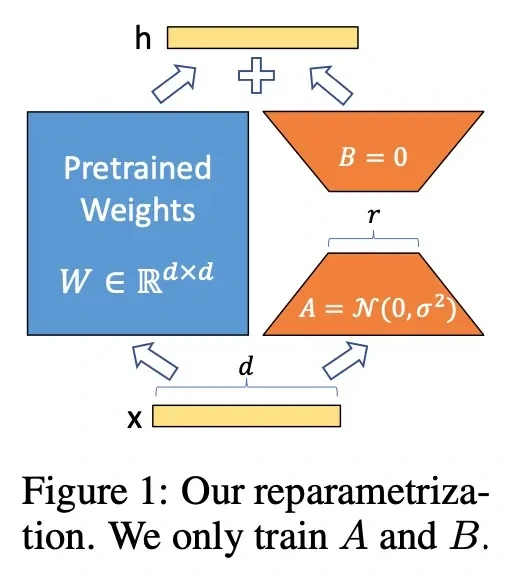

Fine-tuning every weight can be expensive. **LoRA** keeps the original weights fixed and learns a smaller set of low-rank updates.

These updates adapt the model while reducing the amount that must be trained. The article also discusses adapters, which add small trainable modules. Both approaches limit what changes, though they do so in different ways.

*Source: Eugene Yan’s article; underlying paper credits remain in the figure and linked source. Tap to enlarge; the complete figure is preserved.*
