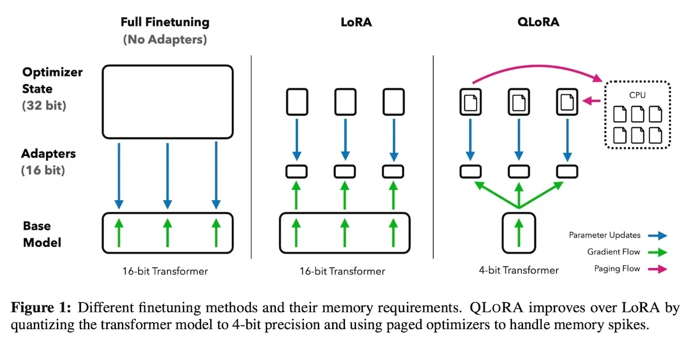

QLoRA combines low-rank adaptation with a quantized base model. The article describes its quantization techniques and paged optimizers as ways to make larger-model fine-tuning more practical within limited accelerator memory.

The important distinction is between adapting a compact set of parameters and storing every base weight at full **precision**. The reported savings are research results for specific setups, not a universal hardware guarantee.

*Source: Eugene Yan’s article; underlying paper credits remain in the figure and linked source. Tap to enlarge; the complete figure is preserved.*
