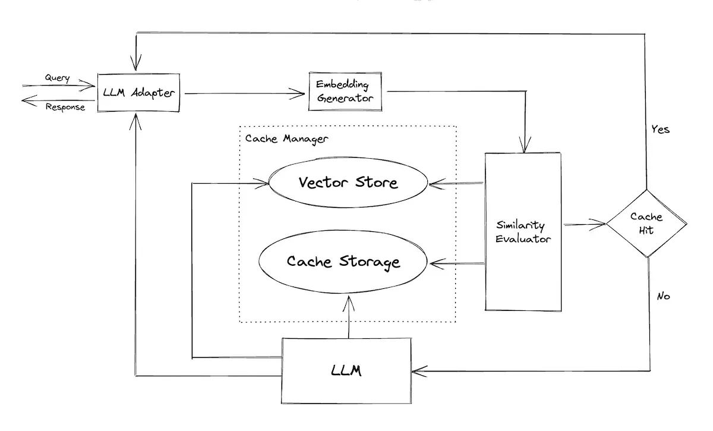

Reusing a previously computed response can reduce generation cost and replace seconds of inference with a faster lookup. Some experiences may require precomputation to meet their **latency** needs at all.

Yan describes both on-demand caching and preparing likely outputs ahead of time. The engineering question is whether the reused answer remains correct for the request being served.

*Source: Eugene Yan’s article; underlying paper credits remain in the figure and linked source. Tap to enlarge; the complete figure is preserved.*
