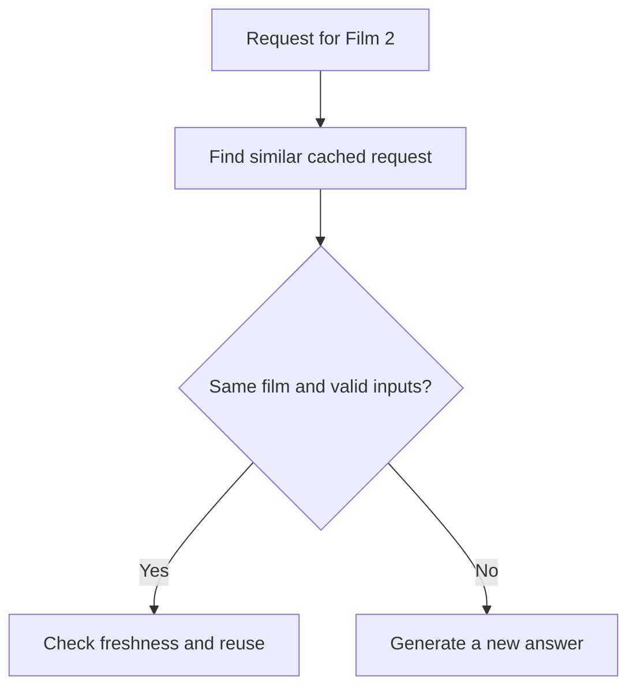

**Illustrative example**

A reader asks for the plot of Film 2. The cache finds a similar request about Film 3.

| Requested film | Cached film | Reuse? |
| --- | --- | --- |
| Film 2 | Film 2 | Check freshness and other inputs |
| Film 2 | Film 3 | No |

Semantic similarity helps find a candidate. The exact film identity decides whether that answer can fit.

*Added explanatory diagram.* [Editable diagram](diagrams/example-54.mmd) · [Portable image](images/example-54.svg)
