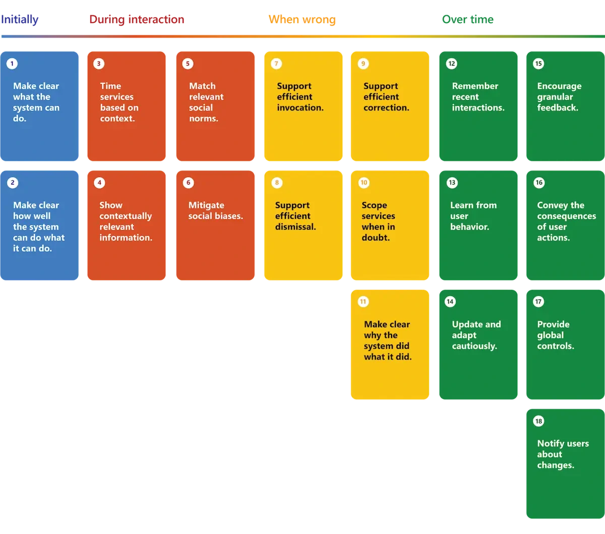

Machine-learning products can produce inaccurate or changing outputs, which challenges a user's expectation of predictable software. Yan recommends designing the experience around this reality.

Defensive UX clarifies capabilities, supports recovery and helps people calibrate trust. It is part of product quality rather than an apology added after the model makes a visible mistake.

*Source: Eugene Yan’s article; underlying paper credits remain in the figure and linked source. Tap to enlarge; the complete figure is preserved.*
