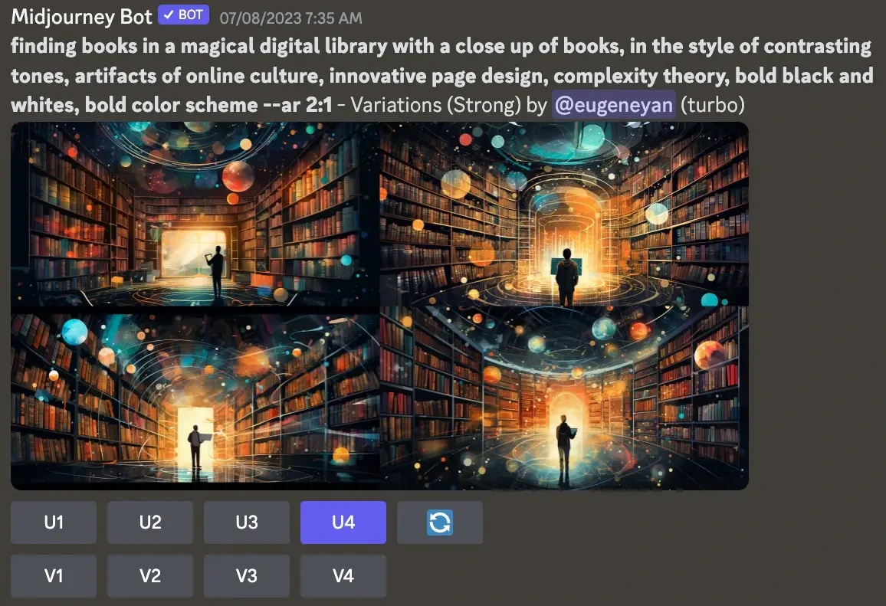

Yan describes thumbs-up or thumbs-down controls, requests for regeneration and image-selection workflows as ways to learn which outputs people prefer. Asking for a variation or choosing to download a result can provide more detail than a generic rating.

The interface should make this feedback easy and actionable, allowing the system to learn during the normal workflow rather than depending entirely on separate annotation sessions.

*Source: Eugene Yan’s article; underlying paper credits remain in the figure and linked source. Tap to enlarge; the complete figure is preserved.*
