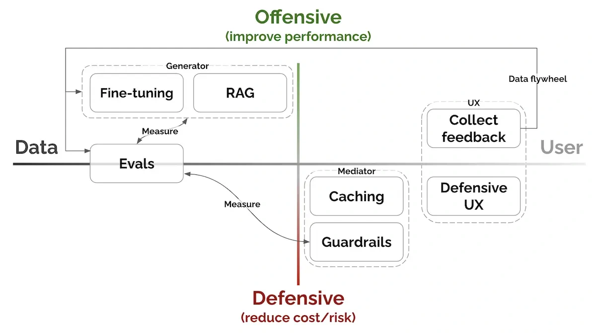

Better data can improve a model, a better experience can increase use, and use can supply further evidence for evaluation and training. Yan describes this as a data flywheel.

He also highlights task decomposition: conventional **retrieval** or specialized components can handle work that a language model need not perform internally, reserving generation for the parts where it adds value.

*Source: Eugene Yan’s article; underlying paper credits remain in the figure and linked source. Tap to enlarge; the complete figure is preserved.*
