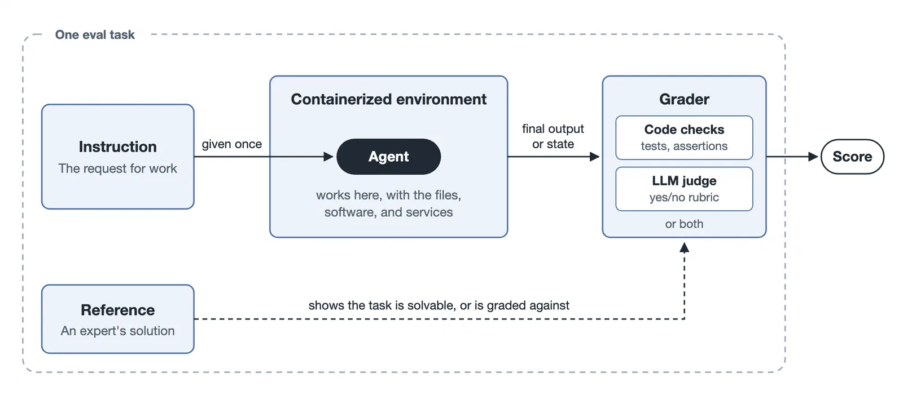

To understand one task, identify its components.

- **Instruction** explains the requested work.
- **Environment** supplies files, tools, and services.
- **Grader** decides whether the result passes.
- **Reference**, when provided, supplies an expert solution or baseline.

A failure can come from a mismatch between these parts. A fair grader needs to accept the valid outcomes the instruction allows.

*Source figure reproduced in Eugene Yan’s article. Credits and original captions are preserved.*
