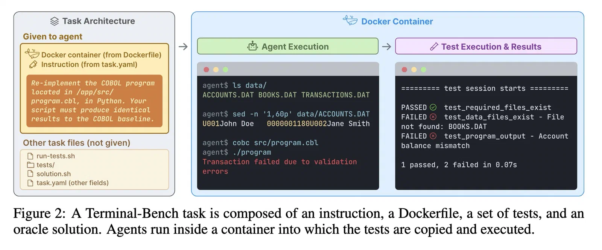

Terminal Bench evaluates command-line work across software, science, operations, and other domains. The article distinguishes its **2.0 paper dataset** from **4.1**, the November 2026 release with 66 tasks.

Agents work in containers with internet access. The neutral Terminus 2 harness offers a terminal. After the agent stops, grading tests inspect the final container state. Every test must pass for the task to earn credit.

*Source figure reproduced in Eugene Yan’s article. Credits and original captions are preserved.*
