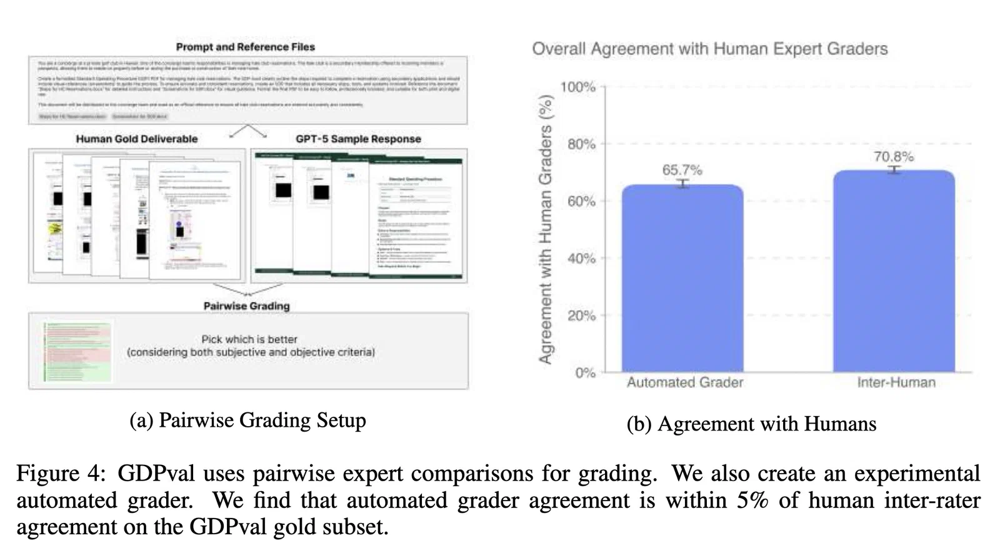

GDPval covers 44 occupations, with 1,320 tasks and a public gold subset of 220. Tasks averaged seven expert hours. Experienced professionals supplied requests, reference files, and their own completed work.

Three experts from the relevant occupation compare unlabeled deliverables. The headline win rate counts comparisons where the model **wins or ties** the human baseline. Knowing that definition matters when reading the percentage.

*Source figure reproduced in Eugene Yan’s article. Credits and original captions are preserved.*
