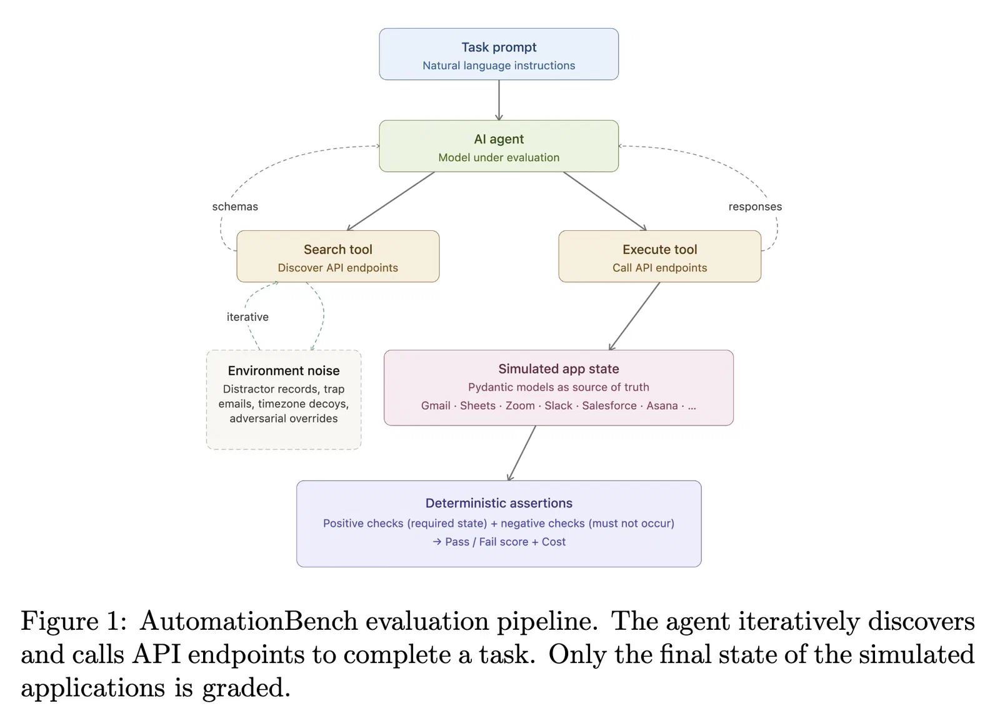

AutomationBench includes 600 public workflows across six business domains and 47 simulated apps. A separate, harder private set drives the leaderboard.

Models get two tools. **Search** finds API schemas. **Execute** calls an endpoint. A run ends when the model stops or reaches 50 steps. All-pass checks inspect final records and messages, including negative checks for actions that should never have happened.

*Source figure reproduced in Eugene Yan’s article. Credits and original captions are preserved.*
