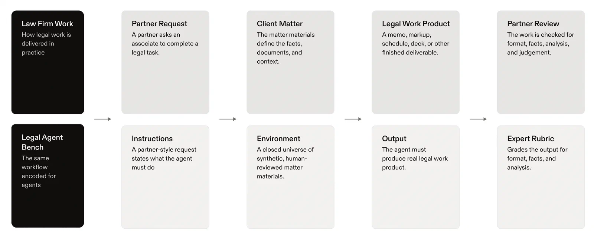

Harvey’s Legal Agent Benchmark turns professional work into partner-to-associate requests. The matter files are synthetic contracts, emails, and templates built around fictional entities. Instructions are brief, and useful evidence appears among peripheral documents.

The public v1.3.0 set described in the article has 2,010 tasks. Leaderboards use a separate 120-task held-out set. Expert criteria check the details a reviewer would scrutinize in the completed work.

*Source figure reproduced in Eugene Yan’s article. Credits and original captions are preserved.*
