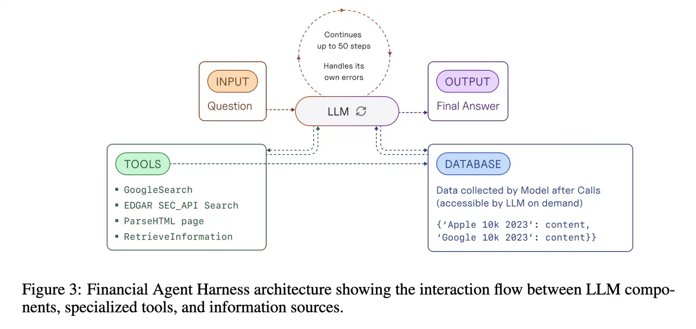

Finance Agent v2.1 has 926 tasks requiring public-company analysis. Useful details can sit in footnotes, accounting policies, or multiple filings.

The common harness offers filing search, web search, parsing, retrieval, a calculator, and price history. It pins available information to before March 1, 2026. The article reproduces an older four-tool diagram, so read it as an illustration of the earlier architecture.

*Source figure reproduced in Eugene Yan’s article. Credits and original captions are preserved.*
